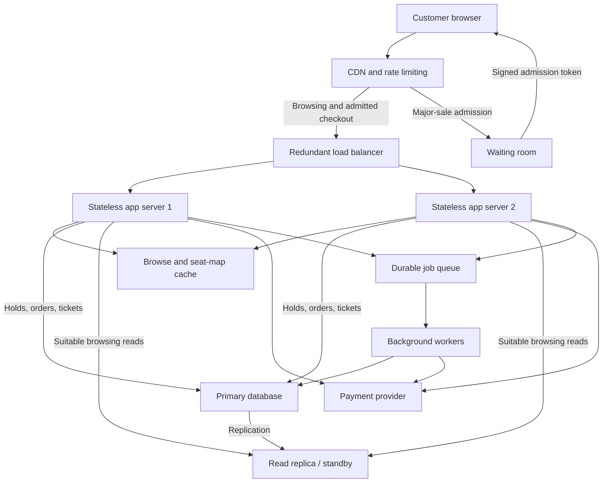

# TicketHub System Design

## 1. Requirements

### Context

TicketHub sells tickets for concerts and events. Customers
browse events, choose seats, pay, and view their purchased
tickets. The system must remain fair and prevent double-booking
when many customers compete for limited seats.

### Functional Requirements

- Customers can browse events and view event details.
- Customers can view seats and their availability.
- Logged-in customers can temporarily hold available seats.
- A hold expires after five minutes if payment is not completed.
- Customers can pay through a payment provider.
- Successful purchases produce tickets customers can view.
- Customers can check their order and payment status.

### Non-Functional Requirements

- Correctness: a seat for an event must never be sold twice.
- Speed: target browsing responses below 300 milliseconds
  for 95% of requests under the planned load.
- Availability: keep browsing available during heavy traffic.
- Fairness: use a waiting room during major sales, admit
  customers in queue order, and enforce purchase limits.
- Security: use HTTPS, authenticate customers, enforce
  ownership checks, and keep card details with the payment
  provider rather than storing them in TicketHub.
- Reliability: payment retries must not create duplicate
  charges, orders, or tickets.
- Scalability: protect checkout and the database during
  the popular-concert traffic spike.
- Observability: monitor latency, errors, queue length,
  payment failures, and expired holds.

These are design targets, not measured results.
During a major sale, waiting-room time is separate from
the response time after admission.

### Assumptions and Scope

- Each event has individually numbered seats.
- Seat availability is tracked separately for each event.
- A customer can buy at most four seats per event.
- The five-minute hold duration and four-seat limit are
  proposed policies that need business approval.
- The payment provider supports idempotency keys and
  authenticated payment notifications.
- Resale, ticket transfers, and refunds are outside
  this initial design.

  ## 2. Traffic Estimates

### Assumptions

- Registered users: 2,000,000.
- Normal daily visitors: 50,000.
- Each visitor views 10 pages.
- Normal ticket sales: 5,000 tickets per day.
- Use 100,000 seconds per day for rough daily estimates.
- The major sale attracts 200,000 people in 10 minutes.
- Ten minutes equals 600 seconds.
- For an initial estimate, each sale visitor makes one
  purchase attempt and views 10 pages.
- Actual checkout involves several API requests, and
  retries or seat-map polling can increase traffic.

### Normal Day

Page views:
50,000 × 10 = 500,000 page views per day.

Average page views per second:
500,000 ÷ 100,000 ≈ 5 per second.

Average tickets sold per second:
5,000 ÷ 100,000 ≈ 0.05 per second.

Ticket sales are business operations, not individual
database writes: each sale may update several records.

### Popular Concert Sale

Average arriving purchase attempts:
200,000 ÷ 600 ≈ 333 attempts per second.

Estimated page views:
200,000 × 10 = 2,000,000 views in 10 minutes.

Average page views during the sale:
2,000,000 ÷ 600 ≈ 3,333 per second.

Compared with the normal daily average:
3,333 ÷ 5 ≈ 667 times more page traffic.

These are averages over the sale window, not instantaneous
peaks. Arrivals may be heavily concentrated in the first
seconds, so admission control and load testing are essential.

### Demand Versus Supply

200,000 people compete for 20,000 seats:
approximately 10 interested people per available seat.

If all 20,000 seats sell within 600 seconds, the average
successful ticket sales rate is about 33 per second.
That is separate from the much larger number of attempts.

### Design Implication

Browsing is read-heavy and can benefit from a CDN and cache.
Checkout needs controlled admission and strong database
correctness because many people may request the same seat.
The waiting room limits checkout traffic to a tested capacity.

## 3. API Design

All endpoints use HTTPS. Holds, payments, orders, and tickets
require authentication. The server obtains the user ID from
the validated login token, not from a client-supplied owner ID.

| Method | Path | Description | Success |
|---|---|---|---|
| GET | /events | List available events | 200 OK |
| GET | /events/42 | View one event | 200 OK |
| GET | /events/42/seats | View the event's seat map | 200 OK |
| POST | /events/42/holds | Temporarily hold selected seats and create a pending order | 201 Created |
| GET | /orders/81 | View an owned order, hold expiry, and payment status | 200 OK |
| POST | /orders/81/payments | Start payment for an owned, valid held order | 202 Accepted |
| GET | /me/tickets | List the authenticated customer's tickets | 200 OK |
| POST | /payments/webhook | Receive an authenticated payment-provider notification | 200 OK |

### Hold Request

POST /events/42/holds

```json
{
  "seatIds": [101, 102]
}

## 4. Data Model

Use a relational database such as PostgreSQL because seat
ownership, orders, and payments require transactions,
constraints, and clearly defined relationships.

### users

- id: BIGINT, primary key.
- name: TEXT, required.
- email: TEXT, required and unique.

### events

- id: BIGINT, primary key.
- name: TEXT, required.
- venue: TEXT, required.
- starts_at: TIMESTAMP WITH TIME ZONE, required.

### seats

Each row represents one sellable seat at one particular event.

- id: BIGINT, primary key.
- event_id: BIGINT, required foreign key to events.id.
- seat_label: TEXT, required.
- price_pence: INTEGER, required and non-negative.
- currency: TEXT, required.
- status: TEXT, required; available, held, payment_pending,
  or sold.
- order_id: BIGINT, nullable foreign key to orders.id.
- hold_expires_at: TIMESTAMP WITH TIME ZONE, nullable.
- UNIQUE(event_id, seat_label) prevents duplicate seat
  inventory for the same event.

Money is stored in integer minor units rather than
floating-point values. For ZAR, these units are cents;
the column can be named price_minor_units in implementation.

### orders

- id: BIGINT, primary key.
- user_id: BIGINT, required foreign key to users.id.
- event_id: BIGINT, required foreign key to events.id.
- status: TEXT, required; held, payment_pending, paid,
  expired, or cancelled.
- total_minor_units: INTEGER, required and non-negative.
- currency: TEXT, required.
- created_at: TIMESTAMP WITH TIME ZONE, required.
- hold_expires_at: TIMESTAMP WITH TIME ZONE, required.

The server calculates the total from the selected seats
and records the agreed price when creating the order.

### payments

- id: BIGINT, primary key.
- order_id: BIGINT, required foreign key to orders.id.
- idempotency_key: TEXT, required and unique.
- provider_payment_id: TEXT, unique when assigned.
- amount_minor_units: INTEGER, required and non-negative.
- currency: TEXT, required.
- status: TEXT, required; pending, succeeded, failed,
  or refunded.

Payment attempts are recorded separately from orders so
failures and retries can be tracked without losing history.

### tickets

- id: BIGINT, primary key.
- order_id: BIGINT, required foreign key to orders.id.
- seat_id: BIGINT, required foreign key to seats.id and UNIQUE.
- issued_at: TIMESTAMP WITH TIME ZONE, required.

UNIQUE(seat_id) guarantees that only one ticket can be issued
for a particular event-seat. Ticket resale and reissue are
outside this initial design.

### Relationships

- One user has many orders.
- One event has many seats and many orders.
- One order can reserve or purchase several seats.
- Each seat can belong to at most one current order.
- One order can have several payment attempts and tickets.
- Each ticket identifies exactly one event-seat.

The server verifies that every selected seat belongs to
the order's event. Database checks should enforce valid
statuses and require an order reference for held,
payment_pending, and sold seats.

### Useful Indexes

- seats(event_id, status) supports event availability queries.
- orders(user_id, created_at) supports customer order history.
- orders(status, hold_expires_at) helps find expired holds.
- payments(status) helps reconciliation find pending payments.

Primary keys and unique constraints also create indexes.
Indexes speed up suitable reads but add storage and write work.

## 5. Preventing Double-Booking

The database is the authority for seat ownership.
A cached seat map or waiting-room position does not reserve
a seat.

### Claiming Seats Atomically

The server starts a short database transaction and creates
a held order. It then attempts a conditional update for each
selected seat, processing seat IDs in a consistent order.

Example for one seat:

```sql
UPDATE seats
SET status = 'held',
    order_id = :order_id,
    hold_expires_at = CURRENT_TIMESTAMP + INTERVAL '5 minutes'
WHERE id = :seat_id
  AND event_id = :event_id
  AND status = 'available';
```

These are PostgreSQL-style statements. Named placeholders
represent separately bound parameters.

The server checks that every requested seat update affected
exactly one row. If any update affects zero rows, it rolls
back the entire transaction and returns 409 Conflict.
Otherwise, it commits the order and all seat holds together.

Concurrent updates to the same seat are coordinated by the
database. After one transaction claims the seat, another
cannot successfully claim it while its status is held.

### Completing Payment Safely

1. In a short transaction, the server locks the order and its
   seats, checks ownership and expiry, and changes them from
   held to payment_pending.
2. It commits before contacting the payment provider.
   No database transaction stays open across a network payment.
3. The payment operation uses an idempotency key so retries
   do not create duplicate charges.
4. An authenticated provider notification triggers another
   short transaction that locks the order and its seats.
5. After verifying the amount, currency, payment outcome,
   and seat ownership, the server marks the order paid,
   marks the seats sold, and inserts the tickets atomically.

A UNIQUE constraint on tickets.seat_id prevents two tickets
being issued for the same event-seat. Repeated notifications
for an already completed payment are acknowledged without
issuing additional tickets.

### Expired Holds and Uncertain Payments

A background worker releases expired held orders in a
transaction that locks the order and its seats. It clears
the seat ownership only if the seats still belong to that
order and remain held.

The payment-start operation uses the same locking order.
This prevents hold expiry and payment initiation from
successfully changing the same order at the same time.

Seats in payment_pending are not automatically released
when the original hold timer expires. A reconciliation
worker checks the payment provider and resolves uncertain
outcomes.

Before releasing payment_pending seats, the system must
establish that payment has failed or been cancelled and
cannot subsequently succeed. A late successful charge
for an order that cannot be fulfilled is refunded rather
than assigning an already sold seat.

### Enforcing Purchase Limits

The server locks the customer's user row while checking
their existing active reservations and purchases for the
event and creating a new hold. This serialises competing
hold requests from the same account and enforces the
four-seat limit.

Account limits do not completely prevent someone using
multiple accounts; anti-abuse controls are also needed.

## 6. Architecture



### Component Responsibilities

- **Customer browser:** Displays events and submits seat,
  order, and payment requests.
- **CDN and rate limiting:** Serves static files and public
  cached content while limiting abusive request traffic.
- **Waiting room:** Controls how many customers can enter
  checkout and gives admitted customers signed tokens.
- **Load balancer:** Routes requests to healthy app servers.
- **App servers:** Authenticate customers, validate admission
  tokens, enforce rules, and coordinate purchases.
- **Cache:** Speeds up public event and seat-map reads,
  without deciding whether a seat can be purchased.
- **Primary database:** Authoritatively coordinates seat
  claims, orders, payments, and ticket issuance.
- **Read replica:** Shares suitable browsing reads and
  supports a managed database recovery arrangement.
- **Payment provider:** Processes payments without TicketHub
  storing customers' raw card details.
- **Durable queue:** Buffers background work and retries.
- **Workers:** Expire holds, reconcile payments, and send
  confirmations without slowing normal page requests.

### Handling the Big Sale

The CDN absorbs repeated requests for static files and
cacheable public event information. Cached seat maps reduce
database reads but are explicitly treated as informational.

The waiting room admits customers at a rate established by
checkout load tests. Signed, expiring admission tokens are
checked by the app servers, so calling the API directly
does not bypass admission.

Queue position is assigned by server-controlled arrival
order, and reconnecting customers retain their valid
position. Tokens are bound to the customer session and
cannot simply be reused by another customer.

App servers scale horizontally. Database transactions remain
short, and seat updates use primary-key lookups. More app
servers do not remove the database's capacity limit, so
admission is adjusted using database load and latency.

Browsing can continue during checkout congestion. If the
payment provider is unavailable, payment initiation pauses
and users receive a clear message rather than a false
purchase confirmation.

### Reliability and Monitoring

Use app servers across availability zones, a redundant
managed load balancer, and durable replicated queue storage.

Use managed database failover with fencing to prevent two
primaries accepting conflicting writes. Failover must
preserve acknowledged seat sales through an appropriately
configured synchronous standby; if safe ownership cannot
be established, pause checkout rather than risk double-selling.

Keep separate backups and test restoration. Monitor request
latency, errors, admission rate, database contention, queue
depth, hold expiry, and unresolved payments.

## 7. Trade-offs

### Correctness Versus Checkout Availability

If the database cannot safely confirm seat ownership,
TicketHub pauses purchases instead of risking double-booking.
Customers may have to wait, but confirmed sales remain reliable.

### Fast Browsing Versus Fresh Seat Maps

Caching makes event pages and seat maps faster and reduces
database load. However, a displayed seat may already have
been claimed. The primary database checks availability
again when a customer requests a hold.

### Fair Admission Versus Immediate Access

A waiting room protects checkout and gives customers a
controlled order of admission. It adds waiting time and
operational complexity, and admission does not guarantee
that seats will remain available.

### Hold Duration Versus Seat Availability

Five-minute holds give customers time to pay, but temporarily
remove seats from sale even if the customer abandons checkout.
Expiry workers release unused holds. Uncertain payments
require reconciliation before their seats can be released.

# Course Reflection

The most difficult concept for me was JavaScript. I am still
learning how variables, functions, arrays, and event listeners
work together to make a page interactive. Following examples
step by step, running the code, and checking the browser Console
helped me make progress. When errors appeared, looking at the
error messages and reviewing the relevant code helped me
understand what needed attention. I have not fully overcome
this challenge yet, but I am becoming more familiar with it.

I have not received feedback on my capstone yet, so I cannot
identify an improvement based on audience feedback. From my
own experience, I would improve my ability to explain the
JavaScript and design decisions confidently without relying
heavily on notes or AI assistance. I would also rehearse the
demo so I can explain what happens when a request succeeds
or fails.

My next priority is consistent practice across HTML, CSS,
JavaScript, APIs, SQL, and system design. I want to rebuild
small features independently, attempt solutions before asking
for help, and use documentation and debugging tools more
often. My goal is to use AI as support for understanding,
while developing the confidence to write and explain my
own work.